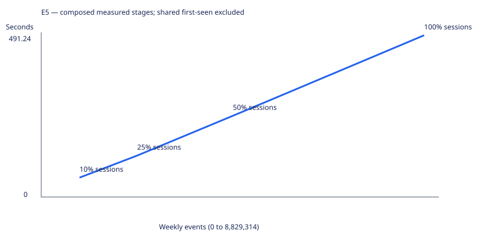

# TV2 — Phân tích kết quả E1–E5 — 24/11/2026

Nguồn tính toán: bản sao raw JSON từ VM, không lấy số từ các summary TV3 làm đầu vào. Danh mục file/SHA-256 tại `metrics/tv2-analysis-20261124/source_manifest.json`; 9 predictions files được tính lại metric trực tiếp trên VM, kiểm tra session không trùng và Top-20 unique/không token 0/1/2. Kết quả tại `prediction_checks.json`. Tất cả số dưới là một lần chạy/config, seed 1; không có mean/std qua các lần lặp.

Lệnh tái tạo: `python -m scripts.analyze_results` từ root, trên output path mới hoặc lưu trữ output cũ trước khi chạy lại. CSV đầy đủ ở `reports/tables/tv2-20261124/`; có run_id và source path. Biểu đồ SVG/CSV/JSON tại `reports/figures/tv2-20261124/scalability/`.

## Những đúc kết sau khi chạy thực nghiệm

Các đúc kết dưới đây tổng hợp run E1–E5 và thống kê preprocessing của đúng bộ cuDF đã chọn; bằng chứng chi tiết nằm trong các mục tương ứng và phần bổ sung theo góp ý giảng viên. Đây là kết quả trong điều kiện đã đo, không phải bảo đảm cho mọi dữ liệu/máy chạy.

### 1. Cleanup định hình lại ý nghĩa bài toán

View chiếm khoảng **96,21% raw event tuần**, tăng lên **99,98% cleaned event ở subset 100%**. Code loại sản phẩm lặp liên tiếp không phân biệt event type, nên `view A → cart A → purchase A` có thể rút thành một A. Đây là cơ chế có thể làm giảm event cart/purchase; chưa audit từng dòng bị bỏ để quy toàn bộ thay đổi cho riêng cơ chế này. Vì vậy metric hiện đo **next-product trong chuỗi đã cleanup**, chịu ảnh hưởng mạnh của browsing; chưa chứng minh dự đoán mua hàng hay tăng conversion. Tỷ lệ event toàn bộ cleaned data không phải tỷ lệ event type của final test target.

### 2. Kết quả chỉ bao phủ session có đủ lịch sử

Trong **1.877.365 session** của tuần 100%, **912.061 session (48,58%) chỉ còn một interaction sau cleanup**, còn **965.304 session (51,42%)** đủ ít nhất hai interaction để tạo prefix/target. **Không được hiểu rằng cleanup làm mất gần nửa session**: nhóm 48,58% gồm cả session vốn chỉ có một event và session nhiều event bị rút còn một sản phẩm; thống kê hiện chưa tách số lượng hai nhóm.

Ví dụ: `A` và `A → A → A` đều thành `A`, không tạo được cặp lịch sử/next-item; `A → A → B` thành `A → B`, dùng A dự đoán B. Do đó accuracy chưa áp dụng cho toàn bộ single-click/cold-session traffic. Đây là giới hạn coverage của protocol, không phải tỷ lệ dự đoán sai hay số dòng bị lỗi.

### 3. Ít session hơn vẫn có thể chứa nhiều sản phẩm chung

Subset 10% có **63.398/118.333 sản phẩm**, bằng **53,58% vocabulary** của tuần 100%. Phân bố độ dài sau cleanup gần mức 100% (TV lớn nhất khoảng 0,001824; median 2, p90 8 và p95 12 ở cả bốn mức). Điều này hỗ trợ dùng subset nhỏ để kiểm tra pipeline và thực nghiệm giới hạn tài nguyên. Tuy nhiên chưa chứng minh đại diện toàn bộ long tail, nhóm user hoặc phân bố theo thời gian; không suy rằng 10% session tương đương 53,58% chất lượng dữ liệu hay đủ thay thế run 100%.

### 4. Điểm cần tối ưu thay đổi khi dữ liệu lớn lên

Trong tổng stage E5 không gồm first-seen chung, preprocessing chiếm **51,68% ở 10%**, còn training chiếm **88,06% ở 100%**. Tăng tốc đọc file đơn thuần khó giải quyết bottleneck training ở mức lớn. Nên ưu tiên theo stage chi phối tại quy mô mục tiêu, thay vì tối ưu cùng một bước cho mọi subset. Đây là tỷ trọng elapsed stage, không phải CPU/GPU utilization.

Event tăng khoảng **10.00 lần**, tổng stage tăng **8.34 lần** từ 10% lên 100%; chi phí trên triệu event giảm, phù hợp với việc phân bổ chi phí cố định lên nhiều dữ liệu hơn. Bốn điểm đo trên một máy chưa đủ để khẳng định distributed speedup, asymptotic complexity hoặc ngoại suy ngoài miền dữ liệu đã chạy.

### 5. Batch lớn là tradeoff, không phải cải tiến miễn phí

E3 batch 128 có process runtime nhanh hơn batch 32 khoảng **1.47 lần**, nhưng Recall@20 giảm từ **19.64% xuống 12.99%** trên cùng validation. Cùng số epoch nhưng số optimizer updates khác nhau; chưa thể kết luận batch lớn luôn tốt hơn. Eval batch vẫn 32 nên inference wall gần nhau. Không dùng sampled RSS hiện tại để tuyên bố tiết kiệm RAM.

### 6. Parquet tiết kiệm storage/read, lợi ích toàn pipeline nhỏ hơn

E4 cùng 882.808 event: Parquet nhỏ hơn CSV **5.28 lần**, timed read nhanh hơn **4.19 lần**; full preprocessing chỉ từ **34.99s xuống 33.57s**. Các bước cleanup/fit/groupby/split vẫn tồn tại, nên không nhân lợi ích đọc thành tốc độ toàn chương trình. Đây là warm-cache single-run measurement, conversion nằm ngoài timed read.

### 7. Kết luận accuracy phải gắn với thiết kế so sánh

Trong cùng test/catalog E1, XLNet có Recall/NDCG cao nhất, Popularity có chi phí thấp nhất; GRU chỉ nhỉnh hơn Popularity ở test hiện tại. E2 quan sát accuracy tăng cùng subset nhưng test/catalog cũng đổi, nên **chưa thể nói accuracy tăng chỉ vì thêm train data**. E2/E5 hiện phù hợp nhất cho kết luận scaling chi phí toàn pipeline. Muốn kiểm tra riêng train-size gain cần thí nghiệm khác giữ validation/test/catalog/mapping cố định; đề xuất này chưa chạy và không thay thế số liệu cũ. Một run/seed và preprocessing fit trước split vẫn là các giới hạn cần nêu khi bảo vệ kết luận.

## E1 — So sánh model

Subset 10%, train partitions 1–6, test partition 7, 1.337 session; kiểm tra cùng session/catalog fingerprints và split counts. K=20, cho phép seen items. Thời gian inference là wall toàn evaluation, gồm input/output/metric, không phải forward latency thuần.

| run_id | Recall@20 | NDCG@20 | train_seconds_including_sequence_io | final_evaluation_seconds | eval_ms_per_session |
| --- | --- | --- | --- | --- | --- |
| e1-popularity-010 | 0.086761 | 0.034766 | 6.552077 | 0.075963 | 0.056816 |
| e1-gru-010 | 0.088257 | 0.038043 | 28.132647 | 0.702583 | 0.525492 |
| e1-xlnet-010 | 0.124907 | 0.051332 | 30.654357 | 0.858062 | 0.641782 |

XLNet có Recall/NDCG cao nhất trong ba run; Recall tăng 43.97% tương đối so Popularity. GRU chỉ nhỉnh hơn Popularity trên test này. Popularity có train/evaluation wall thấp nhất. Chênh lệch accuracy chưa có kiểm định hoặc nhiều seed; không kết luận ưu thế tổng quát. Không so inference với ranking một lần hoặc compute diagnostic. Mỗi run neural còn có daily validation không nằm trong trường train_seconds; process_wall là số riêng bao gồm audit/khởi tạo/checkpoint.

## E2 — Tăng dữ liệu

GRU, train batch 256, eval batch 32, 3 epoch/partition, learning rate 0.00071 và seed 1 cố định; workflow/catalog fit riêng mỗi subset.

| run_id | n_events | n_sessions | Recall@20 | NDCG@20 | raw_read_seconds | preprocessing_seconds | train_seconds_including_sequence_io | final_evaluation_seconds |
| --- | --- | --- | --- | --- | --- | --- | --- | --- |
| e2-gru-010 | 882808 | 1337 | 0.088257 | 0.038043 | 0.172557 | 30.449049 | 27.590926 | 0.701949 |
| e2-gru-025 | 2213138 | 3266 | 0.157379 | 0.071570 | 0.366867 | 34.093408 | 89.228299 | 2.243797 |
| e2-gru-050 | 4421037 | 6427 | 0.274778 | 0.121484 | 0.735025 | 37.860843 | 203.107899 | 5.128254 |
| e2-gru-100 | 8829314 | 13052 | 0.389902 | 0.180376 | 1.359735 | 45.411393 | 432.579236 | 11.888242 |

Accuracy tăng theo mức dữ liệu trong các run này. Các tập test và catalog khác nhau giữa subset, nên đây là kết quả từng kịch bản, chưa cô lập hoàn toàn tác động training data trên một test set cố định. Tỷ lệ subset là tỷ lệ session được sampling; event count là số đo thực. Chi phí first-seen tháng 1.516474s dùng chung được tách riêng.

## E3 — Batch train 32 và 128

Giữ cùng GRU/subset 10%, validation partition 7 gồm 1.324 session; eval batch 32 cố định. Không đặt accuracy validation E3 cạnh test E1 để chọn model tốt nhất.

| run_id | train_batch_size | Recall@20 | NDCG@20 | train_seconds_including_sequence_io | process_wall_seconds | final_evaluation_seconds |
| --- | --- | --- | --- | --- | --- | --- |
| e3-gru-010-b32 | 32 | 0.196375 | 0.090616 | 51.657280 | 65.943116 | 0.715555 |
| e3-gru-010-b128 | 128 | 0.129909 | 0.059083 | 30.592869 | 44.769848 | 0.708310 |

Batch 128 có process wall nhanh hơn khoảng 1.47 lần nhưng Recall/NDCG thấp hơn batch 32. Cùng epoch nhưng số optimizer updates khác nhau nên có tradeoff accuracy/runtime; chưa khẳng định batch lớn luôn tốt hơn. Inference gần nhau vì eval batch không đổi. RSS chỉ mô tả quan sát, không dùng để suy luận tiết kiệm RAM.

## E4 — CSV và Parquet

Cặp full raw subset 10%, 882.808 event, chín cột string và multiplicity-sensitive fingerprint bằng nhau; cùng entrypoint preprocessing/first-seen. Chọn full rerun, loại cặp smoke 19.692 event khỏi bảng chính thức.

| run_id | bytes | read_seconds | preprocessing_wall_seconds_including_read |
| --- | --- | --- | --- |
| e4-full-010-csv | 134004153 | 0.454137 | 34.987557 |
| e4-full-010-parquet | 25382745 | 0.108501 | 33.571249 |

Parquet nhỏ hơn 5.28 lần, timed read nhanh hơn 4.19 lần trong lần đo này. Toàn preprocessing chênh ít hơn nhiều: còn gồm parse/cleanup/fit/groupby/split/write, nên lợi ích read không chuyển nguyên vẹn thành tốc độ cả pipeline. Cache ấm sau verification; conversion/verification ngoài timed read. Preprocessing wall đã gồm lần đọc của pipeline, không cộng thêm standalone read. Chưa có nhiều lần lặp hoặc cold-cache benchmark.

## E5 — Scaling và bottleneck

Tái tính trực tiếp từ bốn successful E2 run bằng `benchmark.scalability`; kiểm tra config hiệu lực/code/environment và không checkpoint replay. Đây là tổng stage ghép: raw_read + preprocessing không gồm raw_read/first-seen + train gồm sequence I/O + final evaluation gồm I/O; không phải wall một process end-to-end. Daily validation/audit/khởi tạo/checkpoint không được gọi là đã bao phủ trong tổng stage.

| run_id | n_events | composed_seconds_excluding_first_seen | seconds_per_million_events | bottleneck |
| --- | --- | --- | --- | --- |
| e2-gru-010 | 882808 | 58.914481 | 66.735328 | preprocessing_excluding_raw_read_and_first_seen |
| e2-gru-025 | 2213138 | 125.932371 | 56.902177 | train_including_sequence_io |
| e2-gru-050 | 4421037 | 246.832022 | 55.831250 | train_including_sequence_io |
| e2-gru-100 | 8829314 | 491.238607 | 55.637234 | train_including_sequence_io |

Event tăng 10.00 lần, tổng stage không gồm first-seen tăng 8.34 lần từ 10% tới 100%. Bottleneck 10% là preprocessing; 25–100% là train gồm sequence I/O. Runtime trên triệu event giảm trong miền khảo sát, phản ánh amortization chi phí cố định; chưa suy ra linearity/asymptotic scaling hoặc hiệu năng ngoài 100%. First-seen được cộng đúng một lần cho từng kịch bản nếu báo tổng có chi phí chung.

## Limitations và phạm vi sử dụng

- Một run/mức, một seed: không có độ lệch chuẩn/confidence interval; không tự tạo mean/std từ session hoặc từ run config khác.
- Preprocessing fit trước split trên tuần mỗi subset theo protocol; đây là offline evaluation, không tuyên bố toàn bộ pipeline train-only. Test không dùng cập nhật model.
- RSS là peak quan sát qua lấy mẫu cây process, có thể đếm trùng shared pages. Truy vấn GPU đồng bộ có thể làm gap vượt 50 ms và bỏ lỡ đỉnh ngắn; không dùng các số này để kết luận RAM khác nhau. Muốn kết luận cần sampler độc lập và rerun liên quan.
- GPU memory sampled, peak CUDA allocated/reserved và total GPU used có scope khác nhau; không hoán đổi. Một GPU Tesla T4, VM 8 vCPU/31 GiB, Docker Merlin; không có kết luận cross-hardware hoặc cost vì chưa có nguồn giá/chi phí đã đo.
- Không warmup riêng, không flush OS cache; E4 cache ấm sau pair verification. Timing thể hiện điều kiện lần chạy, chưa phải SLA latency.
- Chỉ so model trong E1, batch trong E3; E2 thay cả train/eval/catalog. E4 là format raw và preprocessing, không phải tốc độ inference model.
- Gói này hoàn thành phân tích từ logs được kiểm tra; việc bàn giao metrics package chính thức cho TV4/TV5 và người nhận nghiệm thu là task tiếp theo, không tự xác nhận thay người nhận.

---

## Phân tích bổ sung theo góp ý giảng viên — 24/11/2026

### 1. Mẫu số sampling và dòng chảy dữ liệu

10/25/50/100% là ngưỡng chọn **session ID gốc** trong tuần UTC [01/10/2019, 08/10/2019), sau bỏ session null và chỉ giữ view/cart/purchase. Population là **1,877,365 session**, **8,829,314 event**; 100% không phải toàn tháng 42.448.764 dòng. Thuật toán SHA-256(seed 42 + ':' + session ID), lấy 64 bit đầu, ngưỡng floor(p × 2^64/100); cùng hash tạo subset lồng nhau. Các tỷ lệ là kỳ vọng theo session, không phải quota chính xác, user sampling hay event sampling. Seed 42 khác seed GPU split 1. Xem `session_sampling_manifest.json` để tái tạo và checksum membership.

Chọn session rồi giữ toàn bộ eligible event **trong cửa sổ tuần**; sau đó cleanup consecutive repeated product, fit workflow, Groupby, bỏ session <2 interaction, giữ 20 item cuối và chia theo day_index. Vì vậy “giữ nguyên session khi sampling” không có nghĩa model dùng tất cả raw event hoặc event ngoài tuần. Cohort cuối còn bị chọn bởi điều kiện độ dài; phải phân biệt counts raw/clean/model.

| subset_session_threshold_pct | raw_sessions | actual_raw_session_pct | raw_events | actual_raw_event_pct | raw_users | catalog_items | cleaned_events | model_sequences |
| --- | --- | --- | --- | --- | --- | --- | --- | --- |
| 10 | 187563 | 9.9908 | 882808 | 9.9986 | 163847 | 63398 | 638089 | 96433 |
| 25 | 469728 | 25.0206 | 2213138 | 25.0658 | 356271 | 87247 | 1601068 | 241715 |
| 50 | 938071 | 49.9674 | 4421037 | 50.0723 | 601608 | 103940 | 3197007 | 482239 |
| 100 | 1877365 | 100.0000 | 8829314 | 100.0000 | 957543 | 118333 | 6390928 | 965304 |

Raw user counts lấy từ `raw_subset_counts.csv`; số sau cleanup dùng profile của đúng cuDF run trong `e2_preprocessing_verified.json`, không lấy profile DuckDB cũ. Counts user có thể giảm khi cleanup loại event; không trộn hai giai đoạn. Bảng CSV đầy đủ có cleaned users/category/brand và catalog coverage. Snapshot counts và phân bố là bằng chứng đủ quy mô để thực thi các run này, chưa có power analysis hay learning-curve convergence để tuyên bố số mẫu tối thiểu bảo đảm.

### 2. Subset có đa dạng và đại diện không?

| subset | view_pct_clean_events | cart_pct_clean_events | purchase_pct_clean_events | mean_clean_session_length | p50_clean_length | p90_clean_length | p95_clean_length | length_TV_vs_100 | event_TV_vs_100 |
| --- | --- | --- | --- | --- | --- | --- | --- | --- | --- |
| 10 | 99.9752 | 0.0147 | 0.0100 | 3.4020 | 2 | 8 | 12 | 0.0018 | 0.0000 |
| 25 | 99.9770 | 0.0134 | 0.0096 | 3.4085 | 2 | 8 | 12 | 0.0018 | 0.0000 |
| 50 | 99.9789 | 0.0120 | 0.0091 | 3.4081 | 2 | 8 | 12 | 0.0010 | 0.0000 |
| 100 | 99.9778 | 0.0124 | 0.0098 | 3.4042 | 2 | 8 | 12 | 0.0000 | 0.0000 |

TV = 0,5 × tổng trị tuyệt đối chênh lệch xác suất; 0 là cùng phân bố ở đặc trưng đang đo. Bảng CSV còn có max gap giữa hai CDF độ dài. TV độ dài lớn nhất là **0.001824** so mức 100%; đây là khoảng cách mô tả, không phải p-value/kiểm định độc lập (các subset lồng nhau). Phân bố độ dài và event type gần nhau là bằng chứng quan sát rằng hash không làm lệch mạnh hai đặc trưng này trong dữ liệu đã cleanup.

Subset 10% có 63,398/118,333 item, tương đương **53.58% vocabulary** của tuần 100%, dù chỉ có khoảng 10% session. Điều này phản ánh nhiều item được chia sẻ giữa session; không có nghĩa đã bao phủ đầy đủ long tail. Session sampling không chọn đều user: user có nhiều session có cơ hội xuất hiện cao hơn, do đó tỷ lệ user/item không bằng tỷ lệ session. Giữ nguyên record trong session bảo vệ chuỗi hành vi, nhưng session dài vẫn đóng góp nhiều event hơn vào train; metric eval hiện lấy trọng số đều theo session hợp lệ.

Phạm vi đại diện chỉ được hỗ trợ ở **quần thể tuần đầu của dataset này** và các phân bố đã thống kê. Chưa kiểm tra product-frequency/head–tail, brand/category frequency, phân bố theo giờ/ngày hoặc từng nhóm user; distinct counts không thay thế distribution. Chưa có bằng chứng cho đại diện toàn tháng, cửa hàng khác, user mới hoặc production traffic. Không dùng câu “hash bảo đảm đại diện” trong report.

### 3. Mất cân bằng event và tác động của cleanup

| event_type | raw_week_count_including_null_session | raw_week_pct | clean_100_count | clean_100_pct |
| --- | --- | --- | --- | --- |
| view | 8494427 | 96.2071 | 6389507 | 99.9778 |
| cart | 182773 | 2.0701 | 795 | 0.0124 |
| purchase | 152115 | 1.7228 | 626 | 0.0098 |

Raw-week audit có 8,829,315 dòng trước bỏ null session, nhiều hơn population sampling đúng một dòng; bảng trước/sau có scope này, không phải phép đối chiếu từng event. Sau cleanup 100%, view chiếm **99.9778%**, cart+purchase chỉ còn 1,421 event. Chênh lệch rất lớn so raw week cho thấy event mix sau xử lý cần được báo riêng, không chỉ viện dẫn mất cân bằng sẵn có của raw dataset.

Code `pipeline/preprocess_weekly.py` loại consecutive repeated **product_id** trong cùng session, không xét event_type. Vì vậy chuỗi view(A) → cart(A) → purchase(A) có thể bị rút thành một sản phẩm A; event type của dòng được giữ phụ thuộc thứ tự nguồn, nhất là timestamp trùng. Đây là cơ chế có thể làm suy giảm event mua/giỏ sau một lượt xem cùng sản phẩm; chưa audit từng event bị bỏ nên không quy toàn bộ chênh lệch cho một nguyên nhân duy nhất. Quyết định hiện tại giữ preprocessing đã chốt, không cân bằng/oversample từng event làm vỡ session hoặc lặp target.

Baseline chỉ dùng product ID và metric gộp mọi session target. Do đó mục tiêu được đo là next-product trong chuỗi hành vi sau cleanup, chịu ảnh hưởng mạnh của browsing; **không phải purchase prediction, conversion rate hay doanh thu**. Tỷ lệ view trên cleaned events cũng **không phải** tỷ lệ event_type của target cuối tập test: cần join provenance event/target để đo con số đó. Chưa có Recall/NDCG riêng cho view/cart/purchase, nên không tuyên bố hiệu quả mua hàng.

Để kiểm chứng thêm sau này: giữ liên kết event_type của final target khi xử lý sequence, báo support và metric theo từng loại target; audit event type của các dòng bị loại; nếu thử giữ event type trong dedup key phải tạo protocol/artifact/version mới và chạy lại so sánh, không sửa ngược kết quả hiện hành. Đây là đề xuất chưa chạy.

### 4. Selection bias do độ dài và truncation

| subset | event_removed_pct | single_interaction_session_pct | eligible_sequence_session_pct | eligible_sessions_over_20_pct |
| --- | --- | --- | --- | --- |
| 10 | 27.7205 | 48.5863 | 51.4137 | 2.9046 |
| 25 | 27.6562 | 48.5415 | 51.4585 | 2.8852 |
| 50 | 27.6865 | 48.5925 | 51.4075 | 2.8932 |
| 100 | 27.6169 | 48.5820 | 51.4180 | 2.8691 |

Ở mức 100%, **48.58% session** có một interaction sau cleanup và không đi vào model/evaluation. Kết quả vì vậy áp dụng cho multi-interaction sessions, chưa bao phủ single-click/cold-session traffic. Trong các session đủ điều kiện, **2.87%** dài hơn 20; chỉ giữ 20 item cuối gồm target, nên đánh giá ưu tiên phần cuối session và không đo lợi ích của toàn lịch sử dài. Counts interactions trước/sau truncation nằm trong `preprocessing_retention.csv`.

Giới hạn này giúp giải thích bài toán và chi phí: chuỗi tối đa 20 làm bounded sequence compute, còn vocabulary và số session vẫn tăng. Không suy từ time/event mà nói mọi độ dài session đều scale tương tự.

### 5. Audit leakage và hiệu lực so sánh

Counts dưới lấy từ split_counts của raw E2 model metrics, không suy ra bằng phép nhân 80/10/10. Ba cột saved là toàn bộ membership đã lưu; các cột used là đúng phần protocol dùng. Với D=7, train 1–6, daily validation 2–7 và final test 7; train D và test trước D không được đưa vào final benchmark. Validation partition 1 vẫn tồn tại nhưng không có train partition 0 để ghép.

| subset | saved_train_all_days | saved_validation_all_days | saved_test_all_days | train_used_1_to_Dminus1 | validation_used_2_to_D | final_test_D | train_D_not_used |
| --- | --- | --- | --- | --- | --- | --- | --- |
| 10 | 77041 | 9671 | 9721 | 66444 | 8267 | 1337 | 10597 |
| 25 | 193543 | 24450 | 23722 | 166910 | 20933 | 3266 | 26633 |
| 50 | 386564 | 48614 | 47061 | 333758 | 41570 | 6427 | 52806 |
| 100 | 773280 | 96658 | 95366 | 667633 | 82670 | 13052 | 105647 |

| Điểm | Kiểm soát/giới hạn hiện tại | Kết luận được phép |
| --- | --- | --- |
| Session membership | Gom trước split; train/validation/test không trùng session; giữ hash/counts | Tránh trùng nguyên session; không chứng minh split theo user |
| Mapping/thống kê feature | Fit trên tuần từng subset trước split, gồm holdout; cố định qua partition | Có preprocessing nhìn phân bố holdout; không gọi pipeline train-only hoặc đánh giá online inductive |
| Catalog | Real items từ vocabulary tuần, có item chưa xuất hiện train | Ba model E1 cùng catalog; không loại item khó khỏi test bằng train-only catalog |
| Target | Eval item cuối sau truncation; masking/check last label của runner | Trọng số model không nhận target đó trong prefix dự đoán; không xoá giới hạn preprocessing phía trên |
| Thời gian | day_index theo first timestamp của session; cùng model train t, validation t+1 | Không phải cutoff ngày lịch; session nguyên khối có thể kéo dài qua cutoff, chưa strict event-time replay |
| User | Session-based split, không user-disjoint | Có thể có cùng user ở nhiều split; không tuyên bố new-user generalization |
| First-seen | Min timestamp toàn tháng dùng chung; với item trong tuần, min không muộn hơn lần xuất hiện đó | Không gọi mọi feature là chỉ fit train; kiểm tra invariant first_seen <= event_time, không tự suy rằng min tạo future target |
| Test/freeze | Test partition cuối; config freeze trước test theo protocol/log flags | Log/config cho truy vết, không tự chứng minh mọi quyết định thủ công chưa từng nhìn test |

Đây là đánh giá offline có dùng thông tin phân bố từ toàn tuần ở preprocessing; tách rõ leakage target trực tiếp với quyền truy cập covariate/vocabulary của holdout. Các kiểm soát session/masking không đủ để tuyên bố không có mọi dạng leakage. Với triển khai online cần thiết kế temporal replay/fit preprocessing từ quá khứ và đánh giá lại, không gắn nhãn đó lên số hiện tại.

### 6. E2/E5 trả lời câu hỏi nào của đồ án?

**Câu hỏi chính hiện tại:** khi mở rộng quần thể session trong cùng tuần, chi phí đọc/preprocessing/train/evaluation của pipeline thay đổi thế nào? E2/E5 trả lời được theo số event thực, mapping fit riêng, cùng model/resource config và phạm vi đo đã khai báo. Accuracy giữa các subset chỉ mô tả các kịch bản khác nhau vì train, test, catalog đều đổi; **không xác lập quan hệ nhân quả “chỉ thêm train làm tăng accuracy”**.

Thí nghiệm train-size accuracy sạch hơn (đề xuất, chưa chạy): dùng một split nền được lưu membership; khóa validation/test, catalog và mapping cho mọi mức; trong từng train partition chọn các session train bằng cùng stable hash để tạo các mức lồng nhau, giữ nguyên chuỗi; giữ optimizer/epoch/LR/seed schedule đã công bố; eval trên đúng một tập và catalog cố định. Nếu chọn fit preprocessing train-only phải fit một lần trên train nền và ghi rõ vocabulary có thể dùng thông tin từ các train subset lớn hơn; nếu fit riêng từng mức thì phải giải thích catalog/OOV thay đổi, không gọi chỉ thay train size. Báo actual counts, nhiều seed/repeat nếu đủ tài nguyên. Không đổi protocol E2 hiện hành hoặc thay lại số liệu để giả lập thí nghiệm này.

Theo góp ý cô, nhóm có thể ưu tiên **phân tích chi phí và tài nguyên của pipeline hiện có**, không buộc chạy thêm model phức tạp hay dữ liệu lớn hơn. Việc bổ sung thí nghiệm giữ holdout cố định là quyết định phạm vi riêng, không phải bằng chứng đã có.

### 7. Cơ cấu thời gian và khuyến nghị triển khai có căn cứ

| subset | raw_read_share_pct | preprocessing_share_pct | train_share_pct | final_eval_share_pct |
| --- | --- | --- | --- | --- |
| 10 | 0.2929 | 51.6835 | 46.8322 | 1.1915 |
| 25 | 0.2913 | 27.0728 | 70.8541 | 1.7817 |
| 50 | 0.2978 | 15.3387 | 82.2859 | 2.0776 |
| 100 | 0.2768 | 9.2443 | 88.0589 | 2.4201 |

Tỷ trọng trên tổng stage E5 không gồm first-seen; chưa phải CPU/GPU utilization hay whole-job wall. Ở mức nhỏ, ưu tiên tái sử dụng workflow/feature đã fit đúng phiên bản và tránh chạy lại preprocessing không cần thiết; ở mức lớn, train chiếm ưu thế nên batch và số optimizer update là tradeoff có thể kiểm tra từ E3. Không đổi batch giữa E2 vì sẽ phá so sánh data scaling. Parquet giúp storage/read, nhưng read chỉ là một phần nhỏ nên không hứa tốc độ cả pipeline tăng bằng tốc độ đọc.

Việc có VM Ubuntu/Docker/T4 và artifact contract đáp ứng hướng triển khai Big Data/Cloud của nhóm; một máy GPU và pipeline partitioned/streaming **không chứng minh distributed speedup, autoscaling, fault tolerance hoặc cloud rẻ hơn local**. Chưa có cost ledger/utilization/repeated trials cho các kết luận đó. Giá trị của thực nghiệm là pipeline tái lập, phạm vi đo nhất quán, provenance và quyết định kỹ thuật dựa trên bottleneck, không chỉ dung lượng dữ liệu hay độ phức tạp model.

### 8. Kết luận nên dùng khi trình bày

- Trong cùng test/catalog E1, XLNet có metric cao nhất; Popularity có chi phí thấp nhất. Chưa có significance/repeated seed nên dùng “trong các run đã đo”.
- E2/E5 cho thấy chi phí pipeline tăng theo quy mô; bottleneck chuyển từ preprocessing sang train. Accuracy tăng đồng thời là quan sát giữa kịch bản, chưa là isolated train-size gain.
- E3 có tradeoff runtime/accuracy khi đổi batch; không suy từ sampled RSS rằng cấu hình nào tiết kiệm RAM hơn.
- E4 Parquet giảm storage/read, cải thiện full preprocessing ít hơn; warm-cache và chi phí chuyển đổi được tách rõ.
- Tính đại diện được hỗ trợ bởi thống kê quần thể, counts và hai phân bố đã đo; browsing dominance, cleanup, session-length selection, preprocessing fit trước split và một seed là limitations chính.

Nguồn nội bộ: `data/manifests/session_sampling_manifest.json`, `data/manifests/e2_preprocessing_verified.json`, `data/manifests/raw_subset_counts.csv`, `data/raw_audit.csv`, `pipeline/preprocess_weekly.py`, raw E2 logs trong evidence của phân tích chính. Không lấy thống kê tutorial làm số liệu nhóm. Góp ý giảng viên được người dùng cung cấp trong chat; không biến các đề xuất chưa chạy thành kết quả thực nghiệm.
